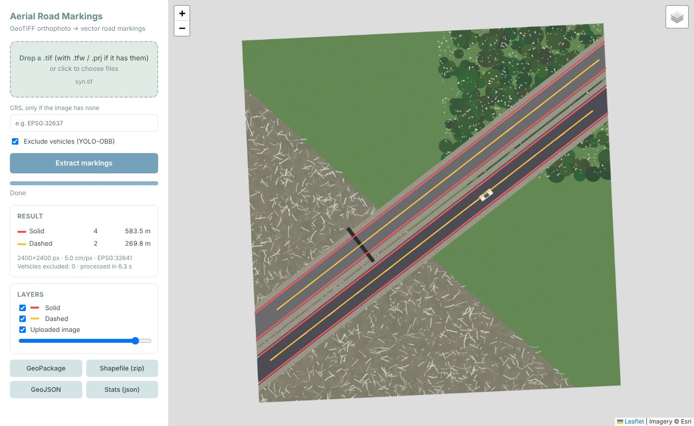
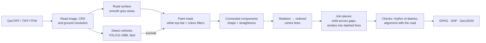

# Aerial Road Markings

Extracts road markings from aerial orthophotos (GeoTIFF) and turns them into
GIS-ready vector lines: solid and dashed markings as separate, measured
features in the coordinate system of the source image.

Built for road survey work, where markings have to be inventoried along
hundreds of kilometres of highway and digitising them by hand takes days.



## What it does

- **Input:** an RGB orthophoto, either a GeoTIFF or a plain TIFF with a world file (`.tfw`) and optional `.prj`.
- **Output:** a GeoPackage with the layers `markings`, `segments` and `vehicles`, a zipped Shapefile and GeoJSON.
- **Attributes of every line:** type (`solid` or `dashed`), length in metres, number of joined pieces, mean paint width.
- **Interfaces:** a command-line tool for batch processing and a web page where you upload an image and inspect the result on a satellite map.

## How it works



1. **Road surface.** Paint only exists on pavement, so the search area is limited first. On a copy downsampled to about 25 cm per pixel, asphalt is found as grey, colourless and smooth at the scale of a metre; grass, gravel, fields and forest are textured or coloured. Morphology fills the markings inside the carriageway, and only large regions are kept.
2. **Vehicles.** A white car is indistinguishable from paint by colour. A YOLO oriented-bounding-box model trained on aerial imagery (DOTA) finds cars and trucks, and their footprints are removed. The image is resampled to the model's training resolution and processed in overlapping tiles, so detection works on orthophotos of any size.
3. **Paint mask.** A morphological white top-hat keeps stripes that are brighter than their surroundings and narrower than the widest marking. Pixels must also be bright and nearly colourless.
4. **Shape filter.** Each blob is measured in metres: length, mean width, elongation and straightness. A marking is long, thin and straight; specks, bent grass blades and car roofs are not.
5. **Centre lines.** Every blob is skeletonised and the skeleton is traced as a graph (longest path first, then long branches). This yields ordered polylines instead of a cloud of points.
6. **Joining.** Pieces are chained end to end when the gap is short, the directions match and the next piece lies on the continuation of the current one. Solid lines are restored across shadows and worn paint; strokes become one dashed line, even when a shadow or a car hides one of them.
7. **Checks.** A dashed line needs at least four strokes, a length of 15 m or more and a steady rhythm of strokes and gaps; debris on the shoulder is irregular. Short strokes standing across the nearest solid line (poles and their shadows) are removed.

All thresholds are set in metres (`src/aerial_markings/config.py`) and converted with the image's ground resolution, so the same settings work for 3 cm and 15 cm imagery.

## Quick start

```bash
git clone https://github.com/faithfoolness/AerialPhotographyProcessing.git
cd AerialPhotographyProcessing
python -m venv .venv
.venv\Scripts\activate             # Windows  (Linux/macOS: source .venv/bin/activate)
pip install -e .[vehicles]         # without [vehicles] the YOLO step is skipped
```

Try it on a generated test image:

```bash
aerial-markings demo -o data/synthetic_road.tif
aerial-markings extract data/synthetic_road.tif -o results/
```

```
synthetic_road.tif: 6 lines in 5.1 s -> results
  dashed     2 lines      269.8 m
  solid      4 lines      583.5 m
  files: synthetic_road_markings.gpkg, synthetic_road_markings_shp.zip, synthetic_road_markings.geojson, stats.json
```

Web interface:

```bash
aerial-markings serve            # then open http://127.0.0.1:8000
```

Your own imagery:

```bash
aerial-markings extract photos/*.tif -o results/
aerial-markings extract tile.tif --crs EPSG:32637   # if the image carries no CRS
```

The YOLO weights (`yolo11n-obb.pt`, 5.5 MB) download automatically on first run.

## Project structure

```
src/aerial_markings/
  raster.py      reading GeoTIFF / TIFF+TFW, CRS resolution, ground resolution
  vehicles.py    tiled YOLO-OBB vehicle detection
  road.py        road surface mask
  mask.py        paint mask (top-hat, colour and vegetation filters)
  vectorize.py   components, shape filter, skeleton tracing
  merge.py       chaining pieces into solid and dashed lines
  pipeline.py    the end-to-end run with timings and statistics
  export.py      GeoPackage, Shapefile, GeoJSON, web preview
  cli.py         command-line interface
  web/           FastAPI app and the map page (Leaflet)
  synthetic.py   synthetic test scene
tests/           pytest: pipeline, CRS handling, web API
```

```bash
pip install -e .[dev]
pytest
```

## Project history

The first version was a prototype that stored every white pixel in PostgreSQL
and grouped pixels with a breadth-first search in Python. It worked, but it
had three problems: about 13 minutes per image, zig-zag lines, and noise from
trees and white cars. Version 2 is a rewrite of the processing core:

| | v1 (prototype) | v2 |
|---|---|---|
| Pixel grouping | BFS over a database table, ~12 min | in-memory connected components, < 1 s |
| Paint detection | fixed threshold R, G, B > 200 | local contrast (top-hat) and colour filters |
| Noise from trees and grass | many false lines | search limited to the road surface, shape and rhythm checks |
| Vehicles | COCO model on the whole image shrunk to 640 px, found nothing | aerial OBB model on native-scale tiles |
| Line geometry | skeleton pixels joined row by row, zig-zags | skeleton traced as a graph |
| CRS | always labelled EPSG:4326 | read from the image or given explicitly |
| Dependencies | PostgreSQL server required | none besides Python packages |

## Limitations

- Designed for nadir RGB orthophotos with a resolution of about 2–15 cm per pixel.
- Yellow (temporary) markings are filtered out as coloured; enable them by raising `max_saturation`.
- Pedestrian crossings, arrows and other symbols are not classified yet. Their pieces are kept in the `segments` layer, and recognising them is a natural next step.
- The road surface detector expects grey asphalt. Very light concrete or snow-covered shoulders may need different thresholds (`RoadParams` in `config.py`).
- The vehicle model is generic. Fine-tuning it on local imagery would improve recall for dark and partially occluded vehicles.

## License

MIT
